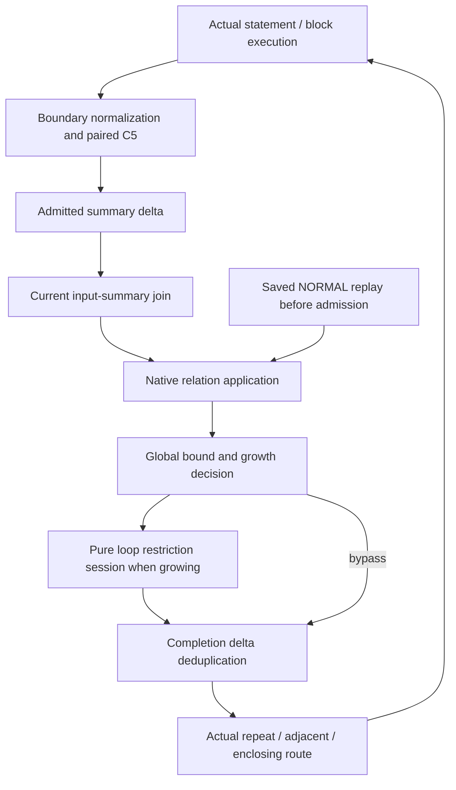

# Loop edge pipeline and lookup complexity

The current [unified loop proposal](bidirectional-loop-propagation-demand-trie-proposal-20261104.md)
consolidates the design. This document remains the detailed source and cost audit.

4 November 2026. Analysis and design direction. No analyzer change is made.

Runtime reference: `e558b496acf82de6ff136325d58f3d90ee5b8559`.
The later `65e230b8c` commit adds reports only. This document expands the C5
direction in the [next-iteration proposal](bidirectional-demand-output-selection-writer-binding-next-iteration-20261103.md).
It does not select a new field, layer, rule or loop-restriction policy.

## 1. Measurement scope and main result

| Project | Latest reached | Latest complete | Accepted forward report |
| --- | --- | --- | --- |
| Conductor | run-6, timeout | run-5 | run-5 |
| Stirling-PDF | run-8, timeout | run-7 | run-7 |

The [performance report](../reports/bidirectional-joined-state-loop-consumers-packed-guidance-performance-20261103.md)
and [fine CPU data](../reports/data/bidirectional-joined-state-query-fine-cpu-20261103.json)
are the measurement sources. Conductor run-6 spends 94.28% of its Java samples
inside loop-consumer observation. Output-path selection alone is 31.15% of all
Java samples. Stirling run-7 has 502.471 million C5 row attempts, despite a
99.972% C5 entry-plan memo hit rate. Its loop observation accounts for 93.16%
of Java samples. These are sampled stack shares and event counts, respectively.

There are two different processes:

1. Actual execution joins a block input with a summary, applies that summary,
   restricts the result, stores its delta and delivers it through the CFG.
2. A pure loop query asks which effects a growing result can have. It can apply
   saved adjacent summaries and intersect their results with enclosing demand.
   It repeats this query to test shorter prefixes. It publishes nothing.

The design should organize both processes around explicit input selection,
relation application and output selection. The first change should remove
owner-wide C5 queries from an already selected entry plan. The next step is to
avoid repeated packet enumeration and repeated identical output operations.

## 2. Terms and preserved behavior

Write a region as `B = BL ; L ; AL`. In forward analysis, the adjacent region
after L is AL. In backward analysis it is BL. The same block tree and physical
ports are used in both directions. AL or BL can contain another decomposition.
Blocks use the original method's register IDs. A local boundary adds no real
call binding, alias remapping or tuple of updated registers. Real method calls
inside a block keep their existing saved-summary, demand and current-summary
handling.

Keep three relations separate:

```text
Body summary:          I -> O       local to the body entry and its actual exit
Enclosing dependency: P -> F       parent entry to the current loop boundary
Demand pair:          E -> X       entry need and exit need in this run's direction
```

`I` is not `P`. A summary application binds `I` to the supplied fact and
preserves the complete enclosing original `P`. C2 asks which initials a fact
can emit from demand entry E. C5 asks which parts of a complete summary
`P -> F` are admitted by the same paired row `E -> X`.

The following behavior stays unchanged:

- Run-1 has no executable ND edge. Later execution must satisfy every ND arm.
  An observer's arm metadata is not an executable witness.
- Saved NORMAL summaries apply before current demand admission. Empty current
  C2 does not suppress saved replay.
- Every new summary is restricted before it enters admitted summary storage.
  This applies to NORMAL and DEMAND results.
- Each C5 row uses its own exit-depth budget, `min(globalLimit, FL(X)+1)`.
  Entry permission from one row cannot use another row's exit permission.
- Growth is a property of the stored summary geometry, before caller suffix
  application: `FL(O) > max FL(I members)`. `FL(Zero)=0`.
- Run-1, Reach and non-growing relations bypass the loop gate. Growing results
  keep the existing shortest-prefix choice and exact observation equality.
- Complete scope, ports, original, marks, tails, exclusions, layers and the full
  protection mask remain part of the appropriate matching/equality checks.
- ZERO, DemandTarget, NormalTarget, native MUST lanes, method-boundary metadata,
  real rule evaluation, source permissions and aliases keep their existing rules.

## 3. Storage and ownership

One method analyzer owns the block tree. A block entry is identified by
`BlockScope(blockId, entryPort)`. Its summaries also retain their output port.
The single normal loop interface remains the selected common join; backward
delivery restores its actual CFG predecessors.

| Storage | Key / contents | Mutable during a run | Purpose |
| --- | --- | --- | --- |
| Post-statement edge store | Statement S, complete original P, grouped result | Yes | Store results after S; deliver fresh deltas only |
| Admitted block summaries | Entry scope, exit port, complete original, grouped conclusion | Yes | Store only C5-admitted summaries; supply publication deltas |
| Pending publications | Exit port and fresh summary deltas | Yes | Batch publication under the method work reservation |
| Current publication index | Whole premise, indexed premise members, grouped outputs / Targets | Yes | Replay current summaries to newly admitted input deltas |
| Standing local inputs | Parent scope, point, complete original, layer, child scope, Facts group | Yes | Join a new publication with inputs already offered to that child |
| ND joins | Actual parent/point/exit, whole premise and layer | Yes | Execute complete AND bindings; retain matched arms |
| Child completion store | Parent entry, child, completion exit, complete original, result | Yes | Deduplicate retained applications before routing |
| Incoming demand | Method, entry scope, paired entry/exit rows and actual output ports | No | C2 initial admission and C5 summary restriction |
| Saved NORMAL records / Targets | Method, physical scope, direction, native relation and annotation | No | Saved replay and pure consumer observation |
| Loop query scratch | Exact view/policy/original keys and annotated packets | One owner quantum | Reuse C2 answers and C5 entry decisions |
| Layout, CFG delivery cache, local liveness | Block/route and instruction/base | Layout fixed; delivery cache filled lazily | Find relevant statements and reject dead local conclusions |

The current scratch has at most 32 C2 answers and 32 C5 plans. Large or
unsupported cases use native queries. Scratch is cleared at quantum end.
This does not bound the work inside one callback: one queued delivery can run
an entire observation and all its prefix trials before it returns.

## 4. Actual execution, in order

### 4.1 Offer an input to a block

```text
offerChild(parent P, actual F, exact child entry):
    apply saved NORMAL DATA summaries to F
    offer saved NormalTarget rows through their existing handling

    if run-1:
        use run-1 abstraction admission
    else:
        admission = child demand.C2(F)
        if admission is empty: return

    register/merge this current input and obtain its fresh delta
    select current publications for that delta
    enqueue their real deliveries
    start newly admitted child initials
```

Saved replay can pass through a block without creating mutable block analysis
state. Current summaries and subscriptions require current demand admission.
An offer can contain a previously seen packet: saved replay still runs first.

### 4.2 Produce and emit a summary

```text
after an ordinary statement S produces P -> F:
    store F AFTER S
    if no new delta: return
    use cached CFG delivery by (S, F.base)
    enqueue the delta at relevant statements or an actual block boundary

at an ordinary block boundary:
    reject a dead local conclusion for that boundary
    retain the ordinary global bound and run-specific canonicalization
    normalize the FLOW summary pair
    select exact paired demand rows for this entry/original/output port
    run C5 and each selected row's depth budget
    merge admitted results into the block's summary store
    queue only fresh result/annotation deltas for publication

at an actual method endpoint:
    run its real boundary rule worklist and sink checks first
    finish the required method-origin metadata
    bound and store the post-endpoint result
    use the common summary normalization / C5 / admitted-publication path
```

Run-1 has no incoming C5 restriction. Root-only summary-base filters and typed
Target/static paths keep their current order. No unrestricted candidate store
is introduced. A failed C5 result is not published.
Dead-local guards do not bypass a real endpoint handler. An ordinary block
boundary does not execute method entry/exit rules.

### 4.3 Publish and apply a current summary

There are two arrival directions. They are not implemented with the same
lookup strategy today.

```text
new input delta:
    query the current publication index by premise geometry
    enqueue candidate relation/member deliveries

new publication delta:
    snapshot ALL standing input groups
    for each fresh row, input and premise member:
        test complete AP matching
        enqueue a matching delivery
```

A delivery walks the summary's output scalars. A unary application currently
does full input matching again for each scalar, then applies the relation.
An ND delivery updates its real AND join. Only complete combinations apply.

`LocalRelationApplication` preserves the complete parent original and its
protection. Native saved matching uses `record=true`; current matching does
not. MUST records split definite and residual lanes. Reverse records use native
transient views. These operations cannot share one match merely because the
base/path is equal.

### 4.4 Restrict an applied loop result and route it

```text
onApplied(summary geometry, parent P, result F, actual exit):
    reject a dead local conclusion
    apply the ordinary global AP limit
    if this is an ordinary loop output and the stored relation grows:
        F = loopGate(P, F)
    for each retained result:
        merge it into the child completion store
        if there is no fresh delta: continue
        enqueue routing through the actual directed exit
```

Repeat and leave results can both use this gate. A repeat result can first
finish the containing L region, pass its summary C5/publication, and then
re-enter L through ordinary block application. It is not a direct jump that
bypasses summary machinery. A leave result enters AL, or BL backward. Typed
method return, exception, Target and run-1 static-shortcut routes stay separate.

Deduplication occurs **after** the gate here. Therefore a small retained
completion set does not bound the number of preceding AP applications or
observer queries.

## 5. Pure observation and prefix restriction

For fixed context C and proposed fact F, the current observation is:

```text
Observe(C, F):
    A = C2 admissions at every adjacent entry, with scope labels
    B = empty exact enclosing-result union
    for each matching saved adjacent relation:
        apply the native relation to F, preserving parent original
        adjust real-boundary metadata through the pure adapter
        normalize the complete FLOW pair
        run enclosing paired C5
        add exact DATA results to B
    inspect saved Target metadata through its separate path
    R = C2 admissions at every repeat entry, with scope labels
    return (A, B, R, labels)
```

The observer does not subscribe, execute rules, emit requests, supply statics,
publish a summary or report a finding. NormalTarget metadata in B is not a
completed executable ND join. Actual replay must still perform its effects.

The signature includes exact admitted initials/layers and enclosing results
with their scope, exit, whole original, facts, protection and Target IDs.
Protection is OR-merged at equal result coordinates. `Facts.equals` alone
does not include that annotation and is insufficient.

```text
loopGate(C, scalar F):
    baseline = Observe(C, F)
    if baseline is empty: drop F
    for budget = 1 .. depth(F)-1:
        candidate = ordinaryLimit(F, budget) // proper cuts are DEMAND
        if Observe(C, candidate) == baseline:
            return candidate
    return F
```

A positive adjacent or repeat result is not permission to skip the other
families. The gate needs complete equality. Budgets are tested in ascending
order; no monotonicity or binary-search property is established.

## 6. Lookup costs in the current code

### 6.1 Units

Use the following quantities. Counts are for one exact owner/scope/port unless
stated otherwise.

| Symbol | Meaning |
| --- | --- |
| h | Concrete accessor-path length for positional lookup |
| d | Counted field depth used by the loop prefix-budget trials |
| L(F) | Expanded scalar path/mark memberships of F |
| T(q), C(q) | Trie nodes and candidate postings visited by query q |
| N | Owner-wide paired demand rows |
| K | Prepared member/row decisions for a fixed complete original and exit |
| k | Accepted decisions in K; at most K |
| s | Distinct full output restriction programs among those accepted decisions |
| I | Standing local input groups |
| a | ND premise arity |
| r, v | Saved record candidates and selected reversed scalar views |
| c | Stored conclusion scalar memberships in a relation/publication |
| t | Proper prefix trials actually evaluated |
| z | Distinct complete output memberships produced |

`L(F)` is not the number of unique nodes in a shared field DAG. Leaf iteration
expands paths and full-mark memberships and creates path/pattern views. A small
field limit bounds depth; it does not bound branches, marks, scopes or offers.
K can exceed N because the same demand row ID can occur for several original
ND members. Compare posting counts in the same row/member-ordinal universe;
an eligible ordinal count is not bounded by a distinct method-row ID count.

For exact AP work, write `Match`, `Apply`, `Restrict`, `Pack`, `Cut` and `Merge`.
These costs include their input/output tree and mark work. They are not O(1).
The table separates candidate lookup complexity from that AP work. Hash-map
bounds are expected bounds; hashing/equality of composite keys can inspect
paths, templates or masks.

`PathTrie` uses hash children. Prefix lookup costs `O(h + prefix postings)`.
Neighborhood lookup costs `O(h + T(q) + C(q))`. It can traverse the whole
descendant subtree at a broad prefix. It is not `O(log N + matches)`.

### 6.2 Catalog

| Lookup / stage | Current selection and cost | Remaining AP/output cost |
| --- | --- | --- |
| CFG next relevant instruction | Cache miss: block CFG BFS, `O(V+E)` relevance visits; hit: returned destinations | Delivery/enqueue per destination; empty results are cached |
| Dead-local boundary check | Bit-set membership per actual route; union of routes when required | No rule/alias scan |
| C2 DATA initials | Enumerate L(F); per scalar visit entry-only demand trie: `O(L(F)·h + sum(T+C))` | Native emit/refinement test per candidate, exact initial union |
| C2 cached answer | Exact annotated packet/view/policy key plus answer retrieval | Projection to scope labels; a large answer may not be cached |
| C5 entry plan creation | Per original member: entry-prefix postings, actual-exit filter, entry test; `O(a·h + entry postings)` plus pattern/key work | K row decisions/tickets retained in the bounded plan |
| C5 prepared hit | Build/hash original templates; enumerate L(F), query OWNER-WIDE byExit, build output ID set, scan K decisions | Exact restriction and cut for every accepted overlapping row |
| C5 exact row | Entry already checked by its ticket | The ticket re-enumerates the raw packet, selects leaves, transports protection, packs, then applies this row's cut |
| C5 native fallback | Output neighborhood IDs plus per-member entry-prefix IDs and actual-port checks | Full native row restriction and cut; run-2 static completion can add graph lookup |
| Prepared `emptyForBase` | Scan K decisions, `O(K)` | No AP application if the supported negative test succeeds |
| Saved direct candidate selection | For every F scalar, query scoped entry/exit tries and deduplicate records | Direct native matching/application; packed output size matters |
| Saved reverse view selection | Candidate record lookup, then each F scalar scans all conclusion leaves of each selected record | Up to `sum_records L(F)·L(record conclusion)` path tests before native view matching/application |
| Input delta → current publications | Indexed premise-member neighborhood and candidate deduplication; borrow outputs for each selected whole premise | Exact matching and application per output scalar or completed ND binding |
| New publication → standing inputs | Snapshot O(I), then `freshRows × I × a` full-match tests | Delivery matches again per scalar; publication delta dedup comes before this join |
| ND completion | Match arms and update existing keyed AND join | Number of complete combinations can be a product of arm alternatives; cannot replace execution by OR |
| Saved Target selection | Premise candidate lookup, member checks, exact NormalTarget ID tests | Keep this separate from DATA-negative proofs and real ND Target execution |
| One full observer | Adjacent C2 + saved lookup/AP + enclosing C5 + Target metadata + repeat C2 | Exact scoped result union, labels and protection |
| One growing scalar gate | Raw observer plus t candidate observers: sum of `1+t` observation costs | Prefix cuts and exact signature comparisons |
| Post-statement / summary / completion dedup | Expected keyed lookup plus grouped `Merge`/subsumption/annotation work | Return fresh deltas; this does not refund earlier queries |

The per-observation C2 bundle already shares labelled and unlabelled answers.
The remaining repetition is across trial facts and across observation versus
later actual admission. The actual `offerChild` does C2 again; it does not
consume the observer's answer today.

### 6.3 Main products

For one prepared C5 query, the current cost includes:

```text
enumerate F
+ owner-wide output-neighborhood postings
+ scan K decisions
+ sum accepted overlapping rows [ enumerate/restrict F + pack + row cut ]
+ result union
```

For one growing scalar, that process sits inside:

```text
for raw and each tested prefix:
    query adjacent and repeat demands
    find saved records/views
    for each saved application output:
        run enclosing C5
    compare the complete signature
```

Thus, a high entry-plan memo hit rate removes only one component. The main
remaining products are offers × prefix variants × saved outputs × output
candidate rows, plus repeated packet enumeration. One scheduler event can
contain many such operations. A low number of physical instruction events or
stored summaries is not proof of low total work.

## 7. Proposed organization

### 7.1 Keep execution and pure queries separate

Use explicit concepts for produced summary candidates, admitted summaries,
matched inputs, applied results and pure observations. These can be private
views/capabilities; they need not become five new persistent stores.



A query result is evidence for selecting a packet. It is not permission to
publish the hypothetical AL composition or bypass actual replay.

### 7.2 Prepare output restriction programs after entry eligibility

For a fixed immutable demand context and complete original P:

```text
prepareOutputPlan(context, P, actual exit):
    select candidate paired rows by P's members
    test each row's complete native entry predicate
    discard rejected decisions from executable output selection
    group accepted decisions by IDENTICAL full exit Pattern and budget
    index those output programs by their exit base/path
    retain original ordinal/provenance for deterministic order
```

This is stronger than an index over K original decisions. Once an entry
ticket is accepted, its output operation reads only its full exit pattern.
Two accepted rows with the same X therefore run the same output restriction
on the same F. They need one program, not two full-packet restrictions.

Keep every source row's entry check before this grouping. Different marks,
tails, exclusions, depth budgets or owners cannot share a program merely
because base/path matches. ND members remain distinct eligibility decisions;
grouping identical output functions does not change a real ND AND join.

The output plan should provide `hasOutputBase(base)` directly from its roots,
rather than scan K decisions for each negative test. Lookup must remain exact
or conservative followed by the original predicate. Unsupported cases retain
the native path.

### 7.3 Enumerate the offered packet once, then join scalars with programs

```text
restrictWithOutputPlan(P, F):
    obtain F's annotated scalar view once
    for each scalar:
        find candidate output programs in THIS plan
        run their unchanged scalar output-restriction operation
        append the selection to that program's row bucket

    for each program in original first-occurrence order:
        pack its selected plain/protected parts as in native restriction
        apply that program's existing depth budget
        union the resulting Facts with the existing result accumulator
```

This changes a row-major repeated scan into a scalar/program join. Selection
does not combine permissions. Each bucket still belongs to one accepted full
output function. Protection must keep its native plain/protected transport.
Pack **before** the per-program cut. Do not assume that limiting distributes
over an arbitrary union of scalar facts.

Let `chi(F)` be candidate scalar/program incidences. The target selection cost
is `enumerate F + plan-trie visits + chi(F)`, followed by per-program packing,
cutting and union. It avoids owner-wide output IDs, a full K scan, rejected
entry decisions and repeated scalar-view creation. In the worst case every
scalar matches every program, so `chi(F)=L(F)·s`. No universal linear bound is
claimed. If `s` is much smaller than K or N, this removes a large multiplier.

Finalization in original program order can still cost O(s) per query. To
process only touched programs, prove that native empty selection packs to no
result, retain their exact ordinals, then restore order. Sorting b touched
ordinals costs O(b log b); a bit-set scan costs O(ceil(s/wordSize)+b). Keep this
ordering cost in the bound. Until that native empty-bucket proof is supplied,
scan all s programs and run their unchanged finalization.

### 7.4 Preserve selected record positions for reverse application

The saved exit index already knows which output position matched a query.
Its current result returns only a Record. The caller then scans all record
output leaves again to construct reversed views.

Expose a path-selective native view query, or preserve the selected output
position in the candidate result. Return only position-related native views,
with their exact mark/tail/exclusion/protection and reversed ports. Reuse the
current `reverseRecordLeaf` operation. Do not eagerly expand every full mark
into a second global scalar index.

The target cost is path discovery plus selected positions/views and actual
application, instead of a cross-scan of all F leaves and every selected
record's whole output. Broad ANY queries can still select many positions.
Prove the selected view set against current `forEachReversedAt`; a helper
that filters exact ancestors differently is not automatically equivalent.

### 7.5 Match a current or saved input before iterating its outputs

The current publication path selects an input with `satisfying`, then delivery
does the same matching for each output scalar. A private checked match can
carry the exact immutable selected packet into application.

```text
selected = match(input snapshot, full native premise, match mode)
for each output of this premise:
    applyMatched(selected, complete parent original, output)
```

Do this separately for current, native-record, MUST-lane and reverse-view
matching. Real output requests and effects remain in actual application.
An inverse input-position index can also make new-publication selection
symmetric with the already indexed new-input path. That replaces scanning
unrelated standing inputs with enumerating candidate pairs. It does not
remove genuinely compatible pairs or full ND combinations.

### 7.6 Use one lazy restriction session for raw and prefix trials

The session owns the exact parent original, loop/direction/ports, immutable
demand and record snapshots, output plans and metadata adapters. Reuse those
descriptors across its raw query and candidate queries. Keep the existing
bounded owner scratch for reuse across sessions; do not add an unbounded
history of raw facts or observation results.

Current observation collects all configured adjacent/repeat entry scopes for
the parent and loop. A plan associated with one actual output port must preserve
that consumer union. It must not silently reduce it to one routed destination.

Evaluate raw first. If its observation is empty, drop it without preparing
broad prefix queries. Otherwise test budgets in the existing ascending order.
Candidate discovery can share trie frontiers and immutable row/view handles,
but it must include consumers reached only by the broader candidate.

```text
raw:    x.a.b.$/T
cut:    x.a.[any]/T
need:   x.a.c.[any]/T
```

The need cannot use the raw sibling fact. The broader cut can produce a
refining admission for c. Reusing only the raw fact's candidate rows would
miss that new observation and could accept an invalid equality. Keep
candidate-to-variant applicability explicit and lazy.

The session can also compare a trial with the baseline directly. It need not
always construct a complete second signature:

```text
if complete adjacent admissions differ: reject this trial
stream final normalized enclosing C5/Target results against baseline
if an irreversible extra result appears: reject this trial
finish checking missing results and protection
if complete repeat admissions differ: reject this trial
accept only after all families match
```

This is early rejection, not early acceptance. A partial plain result may
later gain protection, so it cannot be rejected merely because the baseline
copy is protected. A protected result cannot become plain. Missing results
are checked after the relevant complete family has been visited. Perform this
comparison after native C5 packing/union; do not infer it from partial AP work.

The [demand-trie design](../../spec/demand-trie-loop-restriction.md) specifies
the field cursor, nested terminal payloads and a native C2 witness that can
certify an entire earlier-budget rejection range. It keeps the full observer
and the existing ascending search for budgets without such a certificate.

### 7.7 Reuse admission evidence only at the same actual destination

When a final kept packet is routed, the session may provide its exact DATA
C2 result to the same scope/policy admission operation. This avoids asking the
same question again. The evidence must name the final chosen packet, complete
protection, scope and frozen view. A raw packet's answer cannot be reused for
a selected cut. Other destinations must compute their own answer.

Keep saved replay first, actual rules/requests, current subscription updates
and scheduling wakes. ZERO boundary admission can borrow normal control demand;
ordinary DATA does not. A DATA capability must not stand in for that control
adapter. Do not execute the observer's hypothetical AL result.

## 8. Principal trace

This later forward example uses full T, global limit 4 and no exclusions or
protection. The NORMAL FLOW rows below are saved records; no new FLOW STAR
demand is emitted.

```java
Node B(Value p) {
    Node x = new Node();
    x.g = new Node();
    x.g.h = p; // BL yields p.$/T -> x.g.h.$/T, NORMAL

    while (again()) {
        Node n = new Node();
        n.f = x;
        x = n;
        // Saved L relation: x.*/FLOW -> x.f.*/FLOW, NORMAL
    }
    return x;  // Saved AL relation: x.*/FLOW -> ret.*/FLOW, NORMAL
}
```

Suppose both relevant adjacent and repeat entries need `x.f.[any]/T`. The
enclosing paired demand is `p.$/T -> ret.f.[any]/T`.

Applying the saved L relation to `x.g.h.$/T` produces `x.f.g.h.$/T`, NORMAL,
under parent original `p.$/T`. The stored relation grows from FL 0 to FL 1.

| Gate input | Adjacent/repeat admission at each named entry | AL application then enclosing C5 | Decision |
| --- | --- | --- | --- |
| Raw `x.f.g.h.$/T`, N | `x.f.g.*/T`, D | `ret.f.g.[any]/T`, D; row budget 2 | Baseline |
| Budget 1: `x.f.[any]/T`, D | `x.f.[any]/T`, D | `ret.f.[any]/T`, D | Different; reject |
| Budget 2: `x.f.g.[any]/T`, D | `x.f.g.*/T`, D | `ret.f.g.[any]/T`, D | Equal; keep this cut |

Current code discovers output candidates and performs saved AL/C5 work for
each of these observations. Then actual routing repeats saved replay and C2.
The proposed organization reuses the fixed output programs, discovers scalar
matches selectively, rejects budget 1 after its completed admission mismatch,
and can pass budget 2's exact admission to the matching destination. Actual
execution still produces and publishes its own results.
This trace uses the current C2 cell: same-prefix ANY/T demand and submitted
ANY/T admit ANY/T at DEMAND. The proposal does not change that cell.

For contrast, `while (...) x=x.f` has the saved forward body relation
`x.f.*/FLOW -> x.*/FLOW`. It is non-growing and bypasses the forward gate.
Its reverse relation can be `x.*/FLOW -> x.f.*/FLOW`, which grows and uses the
backward gate. Forward runs can also read opposite-direction saved records,
so reverse-view selection is not exclusively a backward-run cost.

## 9. Complexity target and limits

The target is candidate-pair work, not a promise of constant work per fact:

```text
actual execution:
    fresh input/publication candidate pairs
    + one exact selection per matched input/premise/mode
    + required output applications and complete ND combinations
    + admitted delta storage/routing

pure restriction session:
    fixed-context/output-plan preparation
    + path/position discovery for actually tested variants
    + scalar/output-program candidate incidences
    + native AP/restriction for compatible pairs
    + required row packing/cuts and exact signature comparison
```

If all candidates overlap, the products remain. Broad demand, many full marks,
many outputs and real ND alternatives are intrinsic work under the current
semantics. The proposed design removes unrelated row visits, duplicate output
functions, discarded position information and repeated enumeration/matching.

Do not eagerly build all saved-summary × demand compositions or all prefix
variants. Those products can exceed the current work and memory. Do not make
trial equality a hash-only check. Do not publish a pure observation to avoid
actual summary delivery.

## 10. Proof and measurement gates

The constructive [finite model](../../spec/lean/proposals/loop-edge-query-pipeline-20261104/README.md)
checks candidate filtering and row/scalar regrouping with opaque native
selection and opaque per-row packing/cutting. Its receipt states the exact
scope: 20 kernel-checked theorems and 36 audited declarations pass. It does not
prove Kotlin AP geometry, reverse-view indexing, signature
streaming or JVM complexity. Those adapters need native oracle comparisons.

Before implementation, prove these additional obligations under
[proof-guide.md](../../spec/proof-guide.md):

1. Plan candidate selection retains every native compatible output program.
2. Each row's full entry check precedes any output-function sharing. Sharing
   equal complete exit functions is idempotent under the native result union.
3. Scalar/program regrouping preserves input order, protection, per-row
   packing, depth budget and final merge. No cross-row field budget is used.
4. Path-selective reverse lookup returns all current native views and exact
   annotations without creating a new broad initial or control port.
5. A checked input selection uses the same full native premise and match mode.
6. Trial early rejection implies complete signature inequality; acceptance
   still proves full equality. Prefix order and the baseline-empty rule stay
   unchanged.
7. Admission evidence belongs to the chosen exact packet and destination.
   Current mutations, real effects and work reservations remain ordinary.

Measure before and after, for each named run and hot owner:

- Actual body summaries and scalar applications; input/publication candidate
  pairs, successful matches and repeated matches of the same premise.
- C2 logical calls, native calls and exact admission re-use at delivery.
- K decisions, k accepted decisions and s distinct output functions.
- Owner-wide output postings, plan-local postings, scalar/program incidences,
  full-packet enumerations, per-program restrictions, packs and cuts.
- Saved record candidates, output positions, reversed views and rejected
  record/leaf pairs.
- Raw growing queries, prefix trials, per-family rejection stage and exact
  signature membership counts. Separate baseline work from trial work.
- CPU and allocation by these stages, plus complete iteration times, demand
  frontiers and exact findings. Keep reached/complete/accepted run labels.

No new analyzer experiment or runtime change is part of this design analysis.
The current measurements identify the cost centers. They do not yet measure
the reduction from distinct output functions, positional reverse lookup or
trial early rejection.

## 11. Current source map

Paths are under `core/opentaint-dataflow-core/opentaint-dataflow/src/main/kotlin/org/opentaint/dataflow/bidi/`.

| Source | Main contracts used here |
| --- | --- |
| `engine/BlockRunState.kt:654`, `:685`, `:900`, `:904`, `:941` | Post-S storage, summary normalization/restriction, admitted delta and publication |
| `engine/MethodBlockRuntime.kt:322`, `:400`, `:451`, `:488`, `:666`, `:700` | Saved-first entry, saved candidates, applied gate, routing, prepared C5 and observer views |
| `engine/BlockSummaryLinks.kt:57`, `:88`, `:141` | Input/publication joins, real scalar/ND application |
| `engine/PublicationIndex.kt:69` | Indexed input-to-publication selection |
| `engine/LocalRelationApplication.kt:40`, `:60`, `:79`, `:117` | Current/native/MUST/reverse/Target handling |
| `engine/LoopConsumerObservation.kt:48` | Pure complete observation |
| `engine/LoopOutputRestriction.kt:79`, `:141` | Stored growth and raw/ascending-prefix policy |
| `engine/LoopQueryScratch.kt:28`, `:40` | Bounded exact C2 and entry-plan reuse |
| `engine/BlockBoundaryDemandView.kt:35` | Physical DATA admission and ZERO control adapter |
| `store/DemandStore.kt:53`, `:143`, `:193`, `:259` | Prepared/native C2/C5, candidate selection and row-specific cuts |
| `ap/Demand.kt:82` | Accepted ticket output restriction and per-row packing |
| `store/PathTrie.kt:31`, `:58` | Prefix and subtree query costs |
| `store/RecordStore.kt:27`, `:109`, `:131`, `:161` | Native reverse scans, saved positional indexes and NORMAL persistence |
| `ap/LeafViews.kt:3` | Expanded scalar view creation |
