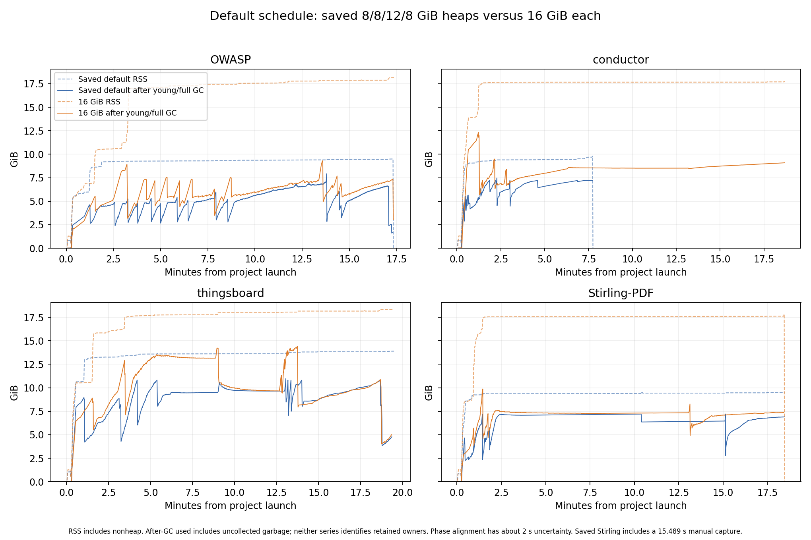

# Default field limits with 16 GiB heaps

Date: 29 October 2026. Primary runtime: `c2bc5e78dfdb13f95bda970c5f4e0c247acbac29`.
Saved default runtime: `2273c824510ed9366ccd2aa65935f8d3561c38d1`.

The 16 GiB heap avoids conductor's earlier OOM, but it does not increase the accepted field limit on any project. All four analyses end on timeout. Stirling run-5 is shorter, while the long work in conductor and thingsboard remains.

These results show that extra memory alone does not complete the selected workloads within their fixed time limits. They do not prove unbounded memory growth or an infinite loop.

## 1. Scope and controls

Compare one new run of each project with the saved [default campaign](bidirectional-demand-storage-predefined-performance-20261028.md). The comparison is not the RUN_INDEX experiment. Neither saved campaign nor the legacy `f945f92` baseline was rerun.

| Setting | Saved default | 16 GiB experiment |
|---|---|---|
| Field limits | REPEAT_RUN1: 1, 1, 2, 3, ... | Same |
| Run-1 marks / statics / default aliases | FULL / enabled / enabled | Same |
| OWASP heap / IFDS timeout | 8g / 1,000 s | 16g / 1,000 s |
| conductor heap / IFDS timeout | 8g / 1,080 s | 16g / 1,080 s |
| thingsboard heap / IFDS timeout | 12g / 1,080 s | 16g / 1,080 s |
| Stirling heap / IFDS timeout | 8g / 1,080 s | 16g / 1,080 s |
| Outer timeout / execution | 1,200 s / sequential Gradle runProjectAnalyzer | Same |

The harness uses `--heap-memory 16g --field-limit-schedule REPEAT_RUN1`. Each actual JVM command has `-Xmx16g`. Here 16g means 16 GiB. The engine and joined static completion retain their 90% memory guard. The later handoff/report barrier retains its 99% guard. The JVM can change its GC layout when the maximum heap changes. No fixed GC-layout or pure capacity-only effect is assumed.

The selected change is the harness heap override. Runtime commit `c2bc5e78dfdb13f95bda970c5f4e0c247acbac29` changes only two harness files. The core and rules tree hashes equal kernel `3284369b2c55065ec99abb327cd9c557a7cbacbd`. No analyzer transfer, rule, cache or storage optimization is added. Same numbered phases have the same direction and field limit in both campaigns.

Prelaunch and final full-content audits pass all 25 datasets and four models. The actual commands, source hashes, tests, input checks and numeric results are in the [embedded data](data/bidirectional-repeat-run1-16g-performance-20261029.json). The separate [OWASP convergence investigation](bidirectional-owasp-demand-convergence-20261029.md) is outside the primary campaign and its tables below.

## 2. Outcomes and accepted field limits

`Reached / complete` gives the latest started engine and latest completed engine. `Accepted / L` gives the latest accepted forward report and its field limit.

| Project | Saved outcome | Saved reached / complete | Saved accepted / L | 16g outcome | 16g reached / complete | 16g accepted / L |
|---|---|---|---|---|---|---|
| OWASP | TIMEOUT | run-12 / run-11 | run-11 / 10 | TIMEOUT | run-12 / run-11 | run-11 / 10 |
| conductor | OOM | run-4 / run-3 | run-3 / 2 | TIMEOUT | run-4 / run-3 | run-3 / 2 |
| thingsboard | TIMEOUT | run-2 / run-1 | run-1 / 1 | TIMEOUT | run-2 / run-1 | run-1 / 1 |
| Stirling-PDF | TIMEOUT | run-6 / run-5 | run-5 / 4 | TIMEOUT | run-6 / run-5 | run-5 / 4 |

Accepted forward field limits remain **10 / 2 / 1 / 4**, in the project order above. Conductor changes from OOM in run-4 to TIMEOUT in run-4. It runs longer but still accepts only run-3. No primary 16g run has an OOM marker or HPROF.

## 3. All iteration times and demand frontiers

Times are engine seconds. F means forward; B means backward; L is the field limit. D is the outgoing demand membership count at a completed frontier. D is not a scalar fact, operation or queue count. `—` means unavailable. A failed or timed-out engine has no completed outgoing frontier; its duration is not its completion time.

### OWASP

| Run | L | Saved seconds | Saved D | 16g seconds | 16g D |
|---|---:|---:|---:|---:|---:|
| run-1 F | 1 | 94.144 | 111,374 | 92.064 | 111,374 |
| run-2 B | 1 | 36.433 | 112,741 | 36.985 | 112,745 |
| run-3 F | 2 | 32.298 | 392 | 33.921 | 394 |
| run-4 B | 3 | 40.904 | 204,035 | 39.733 | 203,966 |
| run-5 F | 4 | 31.092 | 162 | 30.032 | 162 |
| run-6 B | 5 | 51.229 | 330,891 | 49.338 | 330,881 |
| run-7 F | 6 | 31.839 | 162 | 29.872 | 162 |
| run-8 B | 7 | 90.398 | 772,739 | 88.705 | 772,627 |
| run-9 F | 8 | 35.473 | 162 | 33.966 | 162 |
| run-10 B | 9 | 316.428 | 2,543,689 | 304.586 | 2,543,694 |
| run-11 F | 10 | 35.377 | 162 | 41.604 | 162 |
| run-12 B | 11 | 155.504 TIMEOUT | — | 172.288 TIMEOUT | — |

### conductor

| Run | L | Saved seconds | Saved D | 16g seconds | 16g D |
|---|---:|---:|---:|---:|---:|
| run-1 F | 1 | 14.387 | 33,089 | 14.741 | 33,102 |
| run-2 B | 1 | 56.167 | 641,505 | 42.372 | 641,497 |
| run-3 F | 2 | 42.982 | 261,363 | 38.928 | 265,182 |
| run-4 B | 3 | 282.283 OOM | — | 956.363 TIMEOUT | — |

### thingsboard

| Run | L | Saved seconds | Saved D | 16g seconds | 16g D |
|---|---:|---:|---:|---:|---:|
| run-1 F | 1 | 354.334 | 1,928,079 | 351.711 | 1,928,121 |
| run-2 B | 1 | 328.264 TIMEOUT | — | 345.690 TIMEOUT | — |

### Stirling-PDF

| Run | L | Saved seconds | Saved D | 16g seconds | 16g D |
|---|---:|---:|---:|---:|---:|
| run-1 F | 1 | 13.319 | 26,469 | 12.758 | 26,469 |
| run-2 B | 1 | 28.187 | 492,667 | 24.265 | 492,653 |
| run-3 F | 2 | 6.760 | 72,648 | 4.944 | 72,642 |
| run-4 B | 3 | 18.079 | 224,886 | 17.518 | 225,384 |
| run-5 F | 4 | 796.302 | 197,579 | 682.927 | 200,779 |
| run-6 B | 5 | 198.846 TIMEOUT | — | 317.764 TIMEOUT | — |

The saved conductor run-4 duration includes a 15.796 s automatic heap capture. Saved Stirling run-5 includes a 15.489 s manual capture. No manual capture is taken in the 16g campaign. Capture wall intervals are not assumed to be entirely stop-the-world GC pauses.

Stirling run-5 is 113.376 s shorter in raw engine time, or 14.2%. The saved manual capture accounts for 15.489 s of that raw difference. GC and observed work counts also differ, so do not assign the whole gain to one mechanism. Conductor run-2 falls from 56.167 s to 42.372 s. These are single observations, not fixed speedup guarantees.

Longer interrupted durations are not slower completion measurements. Conductor does more work before timeout at 16g than before its old OOM. Thingsboard run-2 receives 345.690 s instead of 328.264 s because earlier phases use less of the shared budget. Both runs remain incomplete.

## 4. Run-1 engine, joined work and barrier

| Project | Saved engine / joined / barrier, s | 16g engine / joined / barrier, s | Saved full interval, s | 16g full interval, s |
|---|---:|---:|---:|---:|
| OWASP | 94.144 / 0.091 / 2.386 | 92.064 / 0.102 / 2.126 | 96.628 | 94.300 |
| conductor | 14.387 / 0.363 / 0.310 | 14.741 / 0.398 / 0.305 | 15.071 | 15.455 |
| thingsboard | 354.334 / 239.536 / 7.330 | 351.711 / 229.759 / 7.544 | 601.308 | 589.039 |
| Stirling-PDF | 13.319 / 0.155 / 0.229 | 12.758 / 0.155 / 0.214 | 13.710 | 13.131 |

Thingsboard still spends 229.759 s in joined static writer binding, versus 239.536 s saved. Both campaigns admit 2,351,008 writer keys. The larger heap does not remove this repeated matching and application work. Run-1 demand counts remain equal or close; small count differences do not prove equality of every decoded row.

## 5. Memory trajectory



The dashed curves are RSS; solid curves are rounded heap-used observations after young/full GC. The numeric curve points are embedded in the data JSON. RSS includes heap and nonheap resident pages. After-GC used can still include uncollected garbage. Neither curve gives a retained-owner census. Committed heap capacity and the maximum heap are separate values. Phase alignment between the rounded manifest clock and resource samples has about 2 s uncertainty.

| Project | Saved wall, s | 16g wall, s | Saved peak RSS, GiB | 16g peak RSS, GiB |
|---|---:|---:|---:|---:|
| OWASP | 1040.751 | 1042.899 | 9.494 | 18.150 |
| conductor | 466.007 | 1120.963 | 9.787 | 17.788 |
| thingsboard | 1171.230 | 1170.202 | 13.893 | 18.335 |
| Stirling-PDF | 1107.876 | 1108.682 | 9.550 | 17.829 |

Conductor run-4 continues past the old OOM point. Late young/mixed observations stay near 8.5–9.1 GiB, below the new maximum, while the engine keeps working until timeout. Stirling run-5 has a long interval near 7.3 GiB after young GC and still takes more than eleven minutes. Thingsboard run-2 ends with a last young/full observation near 10.7 GiB and a large work queue. These are observations, not minimum heap requirements or live-state size estimates.

The larger heap supplies enough headroom to avoid conductor's previous guard failure. It does not remove the time bottleneck or raise any accepted field limit. The finite trajectories do not establish a bound on future state growth. No new OOM heap exists, so there is no fresh 16g retained-owner or static/nonstatic header census. The saved heap analyses remain historical evidence only.

## 6. Admission and scheduler work

The next table uses END minus START of the logged cumulative counters. `Candidates` means initial admission attempts; `new` means new initial admissions. These are not retained live memberships, global unique facts, peaks or queue lengths.

| Phase | Saved candidates / new | 16g candidates / new |
|---|---:|---:|
| conductor run-4 | 3,007,186 / 199,295 | 5,395,498 / 201,266 |
| thingsboard run-2 | 3,283,452 / 581,083 | 3,483,608 / 616,342 |
| Stirling-PDF run-5 | 1,727,027 / 452,280 | 1,800,094 / 466,826 |
| Stirling-PDF run-6 | 832,877 / 139,318 | 907,635 / 146,795 |

Conductor's run-4 handled-event counter stays at 2,649,089 from 09:09:44.550 to 09:16:24.575: a 400.025 s observed span. It later advances again. Handled reservations are not individual AP or fact operations. A work quantum can requeue its reservation, and a whole delivery can run before its event is counted. The flat counter is not proof of zero work or an infinite loop.

Thingsboard's final run-2 progress line reports 3,323,017 handled events and 880,843 in flight. These are scheduler units, not 880,843 facts or demand rows. The embedded phase records retain the whole logged event trajectory.

OWASP forward frontiers at runs 5, 7, 9 and 11 each have 162 demand memberships. The current logs do not expose the actual `result.demandLayerEdges` stopping counter or typed demand payload sets. The frontier's `DEMAND` finding count is a different quantity. Equal counts alone do not prove a fixed point. See the separate OWASP investigation for source and diagnostic evidence; none of its probe results is mixed into this primary campaign.

## 7. Focused CPU and GC evidence

All focused readers run after the four primary analyzers close. The [compact CPU review](data/bidirectional-repeat-run1-16g-cpu-review-20261029.md) and embedded JSON give exact windows, stacks, tool controls and hashes.

| Window | Seconds | Java samples | GC pause union, s | GC collection union, s | Concurrent phase union, s |
|---|---:|---:|---:|---:|---:|
| conductor run4-whole | 956.363 | 25,431 | 6.694 | 278.096 | 272.155 |
| conductor run4-mid30 | 30.000 | 177 | 0.055 | 6.372 | — |
| conductor run4-late30 | 30.000 | 634 | 0.190 | 8.616 | — |
| Stirling-PDF run5-whole | 682.927 | 56,752 | 4.413 | 110.338 | 106.822 |
| Stirling-PDF run5-middle30 | 30.000 | 2,252 | 0.046 | 5.457 | — |
| Stirling-PDF run5-final30 | 30.000 | 2,143 | 0.056 | 2.775 | — |
| Stirling-PDF run6-whole | 317.764 | 48,987 | 5.581 | 128.486 | 123.940 |

Java execution samples exclude native GC worker stacks. Inclusive families overlap and cannot be added or treated as wall-time shares. Native collapsed profiles use CPU sample weights with a different denominator. GC pause, whole-collection and concurrent-phase intervals can overlap and must not be added. Sampled allocation weights are not retained memory.

In conductor's middle 30 s window, 176 of 177 Java samples contain `SubscriptionManager.onDelivery`. Its loop visits publications, premise members and caller-input candidates. This shows delivery work during the flat event counter, but does not identify one exact event for the whole 400 s. GC pause union is only 0.055 s in that window. No native profile covers that middle span, so Java samples do not measure its total CPU use.

Conductor's late window has 74.92% inclusive call-pipeline samples. `DiagonalRelations.borrow` is the Java leaf in 28.23% of 634 samples. The observed replay path searches header scopes and then tests the exact initial. This identifies repeated search for further investigation; it does not count irrelevant scopes or prove a speedup. Late native GC has 47.53% of 5,712 CPU sample weight.

Stirling run-5 has `emitUnchanged` in 34.98% of Java samples. The unchanged path already avoids persistent point-store writes, but still queues successors and classifies instructions. Direct leaves include `CallExprVisitor.defaultVisitJIRInst` at 10.33% and `JIRLanguageManager.getCallExpr` at 8.87%. `FormsCache.withForm` is inclusive in 58.76% and includes its callback; this is not evidence of rebuilding or cache thrashing. The IR API/storage family includes instruction visitors.

Stirling run-5's collection interval union falls from 601.054 s saved to 110.338 s. Its current concurrent-phase union is 106.822 s. The run remains long after this GC pressure falls. GC interval overlap does not turn this difference into a wall-time saving.

Stirling run-6 has 84.23% inclusive call-pipeline samples and 54.52% inclusive protection samples. `NodePair.equals` is the leaf in 22.75%; `intersectTaintMask` is the leaf in 7.91%. The path enters through point admission and protection-mask intersection. NodePair compares node identities, not recursive structural equality. The samples do not separate operation volume from memo-table collision work. Near-limit native GC is 44.70% of 10,786 sample weight; protection is 26.24% of that native denominator.

These profiles localize work that a later proposal can test for removal. They do not authorize a semantic change or prove a twofold workload reduction. No such optimization is implemented in this experiment.

## 8. Saved-default finding identities

Both sides are accepted incomplete candidate reports. All saved-current identities and all occurrence counts are retained.

| Project | Saved / 16g unique | Kept | Missing | Added | Saved / 16g occurrences |
|---|---:|---:|---:|---:|---:|
| OWASP | 4,112 / 4,112 | 4,112 | 0 | 0 | 9,179 / 9,179 |
| conductor | 10 / 10 | 10 | 0 | 0 | 10 / 10 |
| thingsboard | 5,089 / 5,089 | 5,089 | 0 | 0 | 92,016 / 92,016 |
| Stirling-PDF | 31 / 31 | 31 | 0 | 0 | 78 / 78 |

This is identity/location preservation against the saved current reports, not complete-analysis equivalence, a trace witness or a no-FN proof against the legacy baseline. In particular, the three legacy Stirling locations missing from the saved current report remain missing. This experiment does not resolve that earlier finding audit.

The generic comparator records exactly one intentional input difference for each project: `config.memory`, 8g→16g or thingsboard 12g→16g. Unexpected differences are empty, and full content audits pass. The original difference lists and `INCOMPLETE_OR_INVALID_INPUT_COMPARISON` assessment are preserved alongside the allowed/unexpected split. The original lists are not empty.

## 9. Validation and evidence integrity

All 45 harness tests pass, and the project classes build succeeds. Core and rules are unchanged from the selected kernel. Actual JVM commands and model hashes match the fixed configurations. The four primary analyzers close at 10:00:01.780 UTC. Separately authorized OWASP diagnostics run after primary closure and remain outside these results.

All seven focused JFR windows lie within observed recording spans. Java samples have stacks and zero stack truncations. Fresh base and exact-path/concurrent-phase controls pass. Three extension whole-window counts agree with the original reader outputs. The readers use at most 2g and two CPUs. Their larger tool heap is not an analyzer configuration.

Post-reader timestamp wrappers needed two corrections. Their failure logs remain. The successful first reader result was validated and reused; it was not rerun. Raw nanosecond timestamps and the reconciliation receipt are embedded.

The memory parser passes seven synthetic controls. The chart was made after primary closure in an isolated Matplotlib tool environment. Its source, input CSV and output hashes are recorded. No MAT process, manual heap dump or additional primary analyzer configuration was used.

The [data JSON](data/bidirectional-repeat-run1-16g-performance-20261029.json) contains both phase histories, all comparison/counter values, exact frontier and scheduler lines, numeric memory curves, focused CPU results, strict identity counts, input audits, source/command bindings and reader receipts. It is sufficient to read the report without missing external shape-result files. Raw recordings, logs and SARIF remain outside Git under:

```text
/drive-testcomp/opentaint-go-rules/repeat-run1-16g-20261029
```

Before this campaign, 12 prior RUN_INDEX raw heap/profile files were removed after fresh hash and process/open-handle checks: 24,398,855,300 logical bytes. All compact results, logs, SARIF, proof/test/source controls and saved-default heap-analysis data remain. The cleanup receipt supersedes prior claims that those RUN_INDEX raw captures remain available.

Extra heap is useful headroom for conductor, but it does not complete another iteration in these fixed runs. The next work should use the measured search, unchanged-instruction and protection paths to identify avoidable analysis work.
